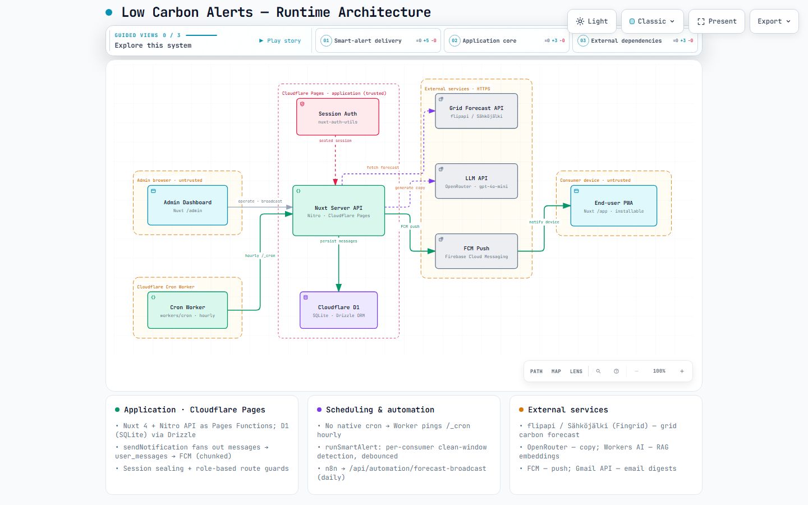

# Low Carbon Alerts

A full-stack web app that tracks Finland's real-time electricity grid carbon intensity and notifies users when clean energy windows open. It helps households shift flexible loads — EV charging, dishwashers, laundry, sauna — to the hours when the grid is greenest, then lets them log what they shifted and see the CO₂ they avoided.

> **Project context.** Built as a University of Oulu **M3S** trainee project. The sections below document the app as it works today; a few items are still in progress (see [Status & roadmap](#status--roadmap)).

---

## Features

**For end users (`/app`)**

- **Live grid data** — carbon intensity, renewable share, and domestic production share, sourced from Fingrid via the Sähköjälki / Flip API.
- **Forecast chart** — interactive history + 24h forecast in Helsinki time, switchable between CO₂ intensity, renewable share, and domestic production.
- **Smart alerts** — personalised push notifications when a clean-energy window opens inside the user's own active hours, with a suggested appliance to run.
- **Appliance Schedule** — log the flexible loads shifted into cleaner hours (an appliance can run several times a day). Each run is priced hour-by-hour against the forecast, and the estimated CO₂ saved is shown per run and as a daily total.
- **Your impact** — estimated CO₂ avoided this week / this month / all-time, a weekly streak, and a community total across all users.
- **Achievements** — milestone badges derived from shift impact.
- **Onboarding & energy profile** — captures housing, appliances, active hours, and goals to personalise alerts.
- **Push notifications** — browser/PWA push via Firebase Cloud Messaging, plus a live in-app inbox.
- **Accounts** — username or email + password, or Google OAuth. Light / Dark / System theme, persisted per browser.

**For admins (`/admin`)**

- **Dashboard** — messages-sent chart, recent messages (grouped by smart-alert run), and key stats.
- **Notifications** — broadcast messages, trigger/preview smart alerts, and manage the daily forecast message.
- **Appliance catalog** — CRUD for the appliance list (icon, power, duration, flexibility, active/inactive) that drives onboarding and smart-alert ranking.
- **Customers** — end-user list with status controls and CSV export of sent messages.
- **Smart-alert settings**, **scheduled jobs**, and an **audit log** of admin actions.

---

## Architecture

Two audiences share one **Nuxt 4** app deployed to **Cloudflare Pages**:

- **End-user app** (`/app/**`) and **admin dashboard** (`/admin/**`), guarded by a named role-based middleware.
- **Nitro server API** (Pages Functions) backed by **Cloudflare D1** (SQLite) through **Drizzle ORM**.
- **Session auth** via `nuxt-auth-utils` (sealed cookies) with optional Google OAuth.
- A separate **Cloudflare Cron Worker** (`workers/cron/`) pings an internal `/_cron` endpoint hourly to run the smart-alert pipeline (Cloudflare Pages has no native cron).
- **External services**, called server-side with held secrets: the Flip API / Sähköjälki (grid forecast), an OpenAI-compatible **LLM** for message copy, **FCM** for push, and **Resend** for email (weekly forecast digest).

📊 **Diagram:** an interactive, explorable runtime diagram is in [`docs/architecture.html`](docs/architecture.html) (open in a browser). A static preview:



For how messages are delivered and where that stops scaling, see [`docs/notifications-architecture.md`](docs/notifications-architecture.md).

---

## Smart-alert pipeline

The smart alert is a **deterministic pipeline with a single LLM call for copy** — not an autonomous agent:

1. **Schedule** — the cron worker calls `/_cron` every hour (authenticated with `NUXT_CRON_SECRET`).
2. **Fetch forecast** — `runSmartAlert` pulls the hourly `consumption_emissions` forecast (cached) and computes the 24h grid average.
3. **Detect a window** — for each eligible consumer it finds the cleanest low-carbon window **inside that user's active hours**, debounced so a user isn't alerted twice for the same window.
4. **Rank an appliance** — picks a suggested appliance from the user's profile using the admin catalog's flexibility ranking.
5. **Generate copy** — one LLM call produces the alert text (detailed or simple, per the user's preference); the numbers come from the deterministic step, not the model.
6. **Persist & deliver** — writes `messages` + per-user `user_messages`, marks it a smart alert in `smart_alert_context`, records the tick in `smart_alert_runs`, and fans out via FCM (chunked) — the DB is the source of truth, so the inbox is correct even if a push is missed.

Users act on an alert via **"I shifted it"**, which opens the Appliance Schedule; the saving is estimated as
`CO₂ ≈ power (kW) × Σ hours × (24h-average − carbon at that hour)`, floored at zero.

---

## Tech Stack

| Concern | Choice |
|---|---|
| Framework | Nuxt 4 (Composition API, `<script setup>`) |
| UI | Nuxt UI v3 + Tailwind CSS v4 |
| Charts | Unovis (`@unovis/vue`) |
| Database | Cloudflare D1 (SQLite) via Drizzle ORM |
| Auth | `nuxt-auth-utils` (sealed cookies) + Google OAuth |
| Push / email | Firebase Cloud Messaging (FCM) · Resend |
| LLM | OpenAI-compatible endpoint (e.g. OpenRouter, `gpt-4o-mini`) for message copy |
| Scheduling | Cloudflare Cron Worker (`workers/cron/`) → `/_cron` |
| Data source | [Flip API / Sähköjälki](https://flipapi.net) (Fingrid) |
| Deployment | Cloudflare Pages (Nitro preset `cloudflare-pages`), auto-deploy on push to `main` |
| Package manager | pnpm |

---

## Data Sources

Grid data is fetched from `https://flipapi.net/forecast/latest` with the following series keys:

| Key | Unit | Interpretation |
|---|---|---|
| `consumption_emissions` | gCO₂/kWh | Lower is better |
| `renew_production_share` | % | Higher is better |
| `domestic_production_share` | % | Higher is better |

All timestamps are displayed in **Helsinki time** (`Europe/Helsinki`).

---

## Database schema

Cloudflare D1 (SQLite) via Drizzle ORM. Main tables:

| Table | Purpose |
|---|---|
| `users` | Accounts (`admin` / `user`); username login, optional email, Google id |
| `user_profiles` | Onboarding answers: housing, appliances, active hours, goals, notification prefs |
| `appliances` | Admin-managed appliance catalog: icon, power, duration, flexibility, active flag |
| `appliance_shifts` | End-user daily shift log — one row per run, with snapshotted estimated saving |
| `messages` / `user_messages` | Sent messages and per-user delivery + read state |
| `smart_alert_context` | Marks a message as a smart alert and its suggested appliance |
| `smart_alert_runs` | One row per hourly smart-alert cron tick |
| `smart_alert_settings` | Admin smart-alert configuration |
| `daily_forecast` | Cached daily forecast message (LLM), one per Helsinki day |
| `recommendations` | Cached per-user recommendation |
| `fcm_tokens` | Registered device push tokens |
| `message_templates` | Reusable admin message templates |
| `scheduled_jobs` · `audit_logs` | Admin scheduled jobs · audit trail of admin actions |
| `kb_chunks` · `kb_meta` | Knowledge-base chunks + metadata for the admin RAG assistant |

The Drizzle schema lives in [`server/database/schema.ts`](server/database/schema.ts); SQL migrations in `server/database/migrations/`.

---

## Getting Started

```bash
# Install dependencies
pnpm install

# Apply migrations to the local D1 database
pnpm db:migrate:local

# Start the dev server (D1 bindings via nitro-cloudflare-dev)
pnpm dev
```

Secrets go in `.env` (and `.dev.vars` for local Cloudflare bindings) — both are gitignored. 

The first admin is seeded via `POST /api/auth/seed-admin` (requires `NUXT_SETUP_TOKEN`).

---

## Development, migrations & deployment

**Scripts**

```bash
pnpm dev              # Nuxt dev server (localhost:3000), D1 via nitro-cloudflare-dev
pnpm build            # production build
pnpm typecheck        # tsc --noEmit
```

**Database (Drizzle + Wrangler)**

```bash
pnpm db:generate       # generate an SQL migration from schema.ts changes
pnpm db:migrate:local  # apply migrations to local D1 (.wrangler/state)
pnpm db:migrate:remote # apply migrations to production D1 (after deploy)
```

Migration workflow: edit `schema.ts` → `pnpm db:generate` → `pnpm db:migrate:local` → deploy → `pnpm db:migrate:remote`.

**Deployment.** Pushing to `main` triggers a GitHub Actions build and `wrangler pages deploy` to Cloudflare Pages. Run `pnpm db:migrate:remote` after any schema change. The cron worker (`workers/cron/`) is deployed separately with its own `wrangler.toml`.

---

## Project structure

```
app/
├── layouts/          # app (end-user) · admin · auth layouts
├── middleware/       # auth.ts — named role-based route guard
├── pages/
│   ├── app/          # Home, Alerts, Forecast, Schedule, Energy Profile, Settings, Onboarding
│   └── admin/        # Dashboard, Notifications, Appliances, Customers, Messages,
│                     #   Smart alert, Scheduled jobs, Inbox, Settings
├── components/       # Shared UI (CarbonChart, ImpactCard, SchedulePicker, …)
└── composables/      # useSchedule, useEmissionsForecast, useAchievements, useLogout, …
server/
├── api/
│   ├── forecast/     # [series].get.ts — cached Flip API proxy
│   ├── schedule/     # Appliance Schedule (GET/POST/DELETE, history)
│   ├── auth/         # login, signup, Google OAuth, profile, seed-admin
│   ├── admin/        # admin-only routes (notifications, appliances, stats, …)
│   └── impact.get.ts # per-user + community saving stats
├── utils/            # runSmartAlert, sendNotification, forecast helpers, estimateSaving
└── database/         # schema.ts, index.ts (useDrizzle), migrations/
workers/
└── cron/             # hourly Cloudflare Worker that pings /_cron
docs/                 # architecture.html (diagram), notifications-architecture.md
```

---

## Status & roadmap

- ✅ Smart alerts, Appliance Schedule, impact/achievements, admin catalog, and auth are live.
- 🚧 Real-time inbox uses in-memory SSE (single-isolate) — see the scaling notes in [`docs/notifications-architecture.md`](docs/notifications-architecture.md).
- 🚧 Smart-alert window length is currently fixed; sizing it from the chosen appliance's typical duration is planned.
